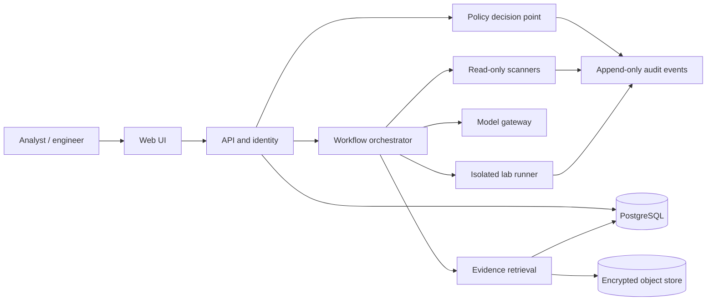

# 141: Open-Source AI Cybersecurity Platform Proposal

**Prepared for:** Sarang K  
**Product name:** 141  
**Status:** Proposal  

## Executive summary

Build 141 as a human-supervised security workbench for defensive analysis and tightly scoped, authorized validation. Its first release should summarize and correlate existing security evidence, review code and dependencies, and produce traceable findings. Start with read-only integrations and a local or single-tenant deployment. Add controlled active testing only after scope enforcement, auditability, and an isolated lab runner have been independently reviewed.

The language model should explain and prioritize evidence; deterministic scanners, policy checks, and human reviewers should establish whether findings are actionable. The product should never treat a model response or a user assertion as proof of permission.

## 1. Purpose, users, and capabilities

**Purpose:** help small security and engineering teams investigate alerts, find and remediate vulnerabilities, and validate owned or explicitly authorized systems without handing an unrestricted shell or network identity to an AI agent.

**Primary users:** SOC analysts, application-security engineers, security researchers working in labs, platform/DevSecOps engineers, and maintainers of small organizations that need explainable security workflows.

**Core workflows:**

- Ask questions over approved repositories, scan results, asset inventories, and incident artifacts, with citations back to the source record or file and line.
- Normalize security findings into a common schema; deduplicate, prioritize, assign, track, and export them.
- Explain likely impact and remediation options, then create a proposed patch or response plan for human review.
- Run approved read-only checks and controlled lab validations under an explicit scope, time window, and action policy.
- Record the evidence, tool versions, model/version, policy decision, operator, approvals, and outputs for each run.

## 2. MVP and system architecture

Keep the first deployment a modular monolith with isolated worker processes. A modular monolith is easier to operate and secure than a fleet of microservices for an early open-source project; split services only when measured load or tenant isolation requires it.

### Suggested open-source stack

| Layer | Practical starting choice | Notes |
|---|---|---|
| Web client | React + TypeScript | Keep the UI as a client of a versioned API; avoid embedding privileged tool credentials in the browser. |
| API | Python + FastAPI | Pydantic schemas at trust boundaries; OpenAPI contract; async only where useful. |
| Database | PostgreSQL | Users, tenants, scopes, cases, findings, approvals, and audit metadata. Use database migrations and tenant-aware access controls. |
| Object storage | S3-compatible store such as MinIO | Store uploaded evidence and reports encrypted; use short-lived signed URLs and retention controls. |
| Queue | Redis-backed worker queue for MVP | Treat queued payloads as untrusted; workers receive narrowly scoped job credentials. |
| Authorization | OIDC provider plus application RBAC; OPA/Rego for action policy | OPA separates policy decisions from tool execution and supports policy-as-code. [OPA documentation](https://www.openpolicyagent.org/docs) |
| Model access | Provider-neutral model gateway; local inference via vLLM or llama.cpp when appropriate | Record provider, model identifier, quantization, system prompt version, and inference settings. Keep secrets in a secret manager, never prompts. |
| Retrieval | PostgreSQL full-text search first; add pgvector if evaluation shows a need | Enforce tenant and source ACL filters before retrieval; include source references in every answer. |
| Telemetry | OpenTelemetry | Collect traces, metrics, and logs while redacting secrets and sensitive content. [OpenTelemetry signals](https://opentelemetry.io/docs/concepts/signals/) |
| Security checks | Semgrep, OSV-Scanner, Trivy, Gitleaks, Bandit; optional CodeQL where license and deployment terms fit | These tools produce evidence; the model can explain results but should not replace their checks. OSV-Scanner documentation: [Google OSV-Scanner](https://github.com/google/osv-scanner). |
| Defensive telemetry | Begin with imported alerts/findings; later add Zeek/Suricata/Wazuh connectors as optional modules | Avoid requiring broad endpoint access for the MVP. Respect each upstream tool's licensing and data handling. |

These are starting points, not a mandate to deploy every component. Keep adapters behind small interfaces so teams can replace them. Pin and review dependencies, publish an SBOM, scan images, sign releases, and document each component's license.

## 3. Defensive capabilities

### Threat detection and triage

- Ingest selected events and alerts through documented connectors or file/API import; preserve source IDs, timestamps, and provenance.
- Normalize records into an agreed schema such as ECS or OCSF, while retaining the original event.
- Correlate by deterministic rules and time/entity relationships first. Use AI to summarize related evidence, identify missing context, and suggest next investigative questions.
- Show confidence as a calibrated estimate with reasons and evidence links, not as an unexplained probability. Allow analysts to mark false positives and corrections.
- Do not autonomously isolate hosts, disable accounts, delete data, or send notifications in the MVP.

### Vulnerability analysis

- Combine SAST, dependency, secret, container, and IaC scanner outputs; deduplicate by stable identifiers and affected component.
- Enrich with CVE/OSV metadata, package reachability where available, exposure, asset criticality, and remediation availability.
- Produce a ranked queue using transparent factors (severity, exploitability evidence, exposure, business criticality, and fix availability). Keep the factors visible and editable.
- Track remediation status and verify a fix by rerunning the relevant deterministic check.

### Incident response

- Provide evidence timelines, case notes, source links, a checklist, and draft containment or recovery plans.
- Generate response actions as proposals with prerequisites, rollback steps, expected impact, and evidence supporting the recommendation.
- Require an authorized operator to approve any action that changes a production system. Initially, support only export or ticket creation after review.

### Secure code review

- Review diffs and repository context for common vulnerability patterns, unsafe data flow, secrets, authn/authz errors, and insecure configuration.
- Pair model commentary with scanner results; report file and line, exploit preconditions at a high level, confidence, and a concrete fix.
- Avoid claiming a clean bill of health. State what files, languages, rules, and tests were actually checked.
- Generate patches in a branch or sandbox; require CI and human review before merge.

## 4. Authorized testing capabilities

Limit active testing to explicit lab targets or systems for which an organization has recorded permission. Start with non-invasive inventory and configuration checks; add higher-impact validation only behind separate policies and approvals.

Every assessment should require a signed or administrator-approved scope record containing:

- Target identifiers: exact hostnames, IP ranges, repository IDs, or lab asset IDs; reject wildcard or unresolved targets by default.
- Proof-of-control or authorization reference, responsible owner, allowed techniques, prohibited actions, date/time window, rate limits, and emergency contact.
- A scope hash attached to every job. The runner checks each requested target and action against the approved scope immediately before execution.
- Egress restrictions, isolated network namespace/container or disposable VM, non-root execution, resource/time limits, no access to cloud metadata services, and no shared host mounts.
- Safe defaults: passive checks and harmless verification only. No persistence, credential theft, destructive payloads, stealth/evasion, uncontrolled exploitation, or testing third-party infrastructure.
- A stop button that revokes the job token and terminates the runner; preserve audit records and evidence after termination.

Keep the model outside the enforcement boundary. The model may draft a test plan; a deterministic policy engine decides whether the plan is permitted, and the executor validates scope again. A user message like “I own this” is not authorization evidence.

## 5. Safety, privacy, and operational controls

1. **Identity and least privilege:** OIDC, MFA support, tenant boundaries, role-based access, short-lived scoped tokens, and separate identities for each connector. No shared default passwords in production.
2. **Policy checks:** deny by default. Evaluate user, tenant, target, action, time window, rate, and approval state in code/OPA before any tool invocation.
3. **Human approval:** require a second explicit approval for high-impact actions, displaying the exact target, command/API call, data involved, expected effect, and rollback. Expire approvals quickly and bind them to a specific action hash.
4. **Auditability:** append-only event stream with actor, timestamps, target, scope version/hash, tool and model versions, policy decision, approvals, request/result hashes, and redacted output. Restrict access and define retention. Do not log credentials or raw secrets.
5. **Prompt-injection resistance:** treat imported documents, issues, alerts, repository comments, and web content as untrusted data. They cannot grant permission or alter tool policy. Separate tool instructions from evidence, constrain tool schemas, validate all outputs, and limit data egress. OWASP highlights prompt injection and excessive agency as risks for LLM applications. [OWASP LLM Top 10](https://owasp.org/projects/top-10-for-large-language-model-applications/)
6. **Data protection:** self-hosted deployment option, encryption in transit and at rest, tenant-specific retention, configurable redaction, data minimization, no training on customer data by default, and documented model-provider retention settings.
7. **Secure development:** threat model before integrations, dependency pinning, SBOM, signed builds, secret scanning, code review, security regression cases, and coordinated vulnerability disclosure. Use NIST SSDF as a process reference. [NIST SP 800-218](https://csrc.nist.gov/pubs/sp/800/218/final)
8. **Failure behavior:** model outage must not bypass controls. Scanner errors, policy errors, and missing authorization should fail closed for active tasks; clearly mark partial or stale results.

These controls reduce risk; they do not eliminate prompt injection, model error, or misuse. Keep permissions narrow enough that a compromised model cannot directly reach sensitive systems.

## 6. Development roadmap

### Phase 0 — Product and threat model (2–3 weeks)

Interview a small group of SOC and AppSec users. Choose one deployment model and one source of truth for authorization. Define data classifications, threat model, target scope format, retention, and measurable MVP success criteria. Publish architecture decision records and license policy.

### Phase 1 — MVP: evidence and code review (6–10 weeks)

- Single-tenant deployment with OIDC, RBAC, audit events, PostgreSQL, and an API/UI.
- Import a repository snapshot and scanner outputs; run a small set of deterministic SAST/dependency/secret checks.
- Provide cited Q&A and finding explanations using a configurable model adapter. Keep all model actions read-only.
- Produce a reviewable report and suggested patch/diff; require user export/merge.
- Add a benchmark harness and red-team test corpus before inviting external users.

### Phase 2 — SOC workflow (6–8 weeks)

Add one alert connector, case management, evidence timeline, deduplication, analyst feedback, and ticket export. Evaluate false-positive reduction and time-to-triage with a controlled pilot.

### Phase 3 — Authorized lab validation (8–12 weeks)

Add scope records, approval flow, isolated runner, target allowlists, rate limits, egress controls, emergency stop, and lab-only test modules. Run an independent security review and misuse exercises before enabling any production target.

### Phase 4 — Multi-tenant hardening and ecosystem

Only after demand: tenant isolation testing, SSO/SCIM, connector SDK, policy templates, deployment hardening guides, external security review, and wider community governance. Avoid adding autonomous response or arbitrary shell access as a shortcut.

Estimates are planning ranges for a small experienced team; they exclude procurement, compliance audits, and customer-specific connectors.

## 7. Objective evaluation plan

Publish benchmark versions, task sets, prompts, model/provider versions, tool versions, configuration, hardware, cost, latency, and scoring code. Use a held-out set, repeat runs for stochastic tasks, report confidence intervals, and disclose failed tasks. Do not compare a tuned system against an untuned baseline.

| Dimension | Evaluation | Metrics |
|---|---|---|
| Code task completion | SWE-bench Verified or a clearly versioned subset; run identical sandbox, time, and tool budgets for 141 and coding-agent baselines | Tests passed, resolved issues, regression rate, time, token/API cost |
| Cybersecurity risk and capability | Meta CyberSecEval suite for relevant categories; add project-owned defensive and policy-abuse tests | Task success, unsafe-completion rate, refusal precision/recall, false refusal rate |
| Detection/triage | Labeled, de-identified alert corpus with known incidents and benign noise | Precision, recall, F1, calibration, analyst minutes per case, missed high-severity cases |
| Vulnerability analysis | Curated vulnerable and clean repositories; scanner-only vs model-assisted; security experts adjudicate | Precision/recall by class, false positives per KLOC, fix correctness, regression rate |
| Secure code review | Same diffs and repository context for 141, static tools, and selected coding assistants | Finding validity, severity agreement, actionable fix rate, review time, hallucinated findings |
| Authorization and abuse resistance | Adversarial tests for scope bypass, prompt injection, stale approval, confused deputy, tenant leaks, and runner escape | Block rate, exploitability, time-to-detect, audit completeness; target zero unauthorized actions |
| Operations and privacy | Load and resilience tests with synthetic data; inspect logs and outbound traffic | p50/p95 latency, availability, resource/cost per task, sensitive-data leakage incidents |

Compare against leading coding assistants (for example, OpenAI Codex, Anthropic Claude Code, GitHub Copilot coding agent, and Cursor Agent) only using accessible versions and documented evaluation settings at test time. [Codex](https://openai.com/codex/), [Claude Code](https://code.claude.com/docs/en/overview), [GitHub Copilot coding agent](https://docs.github.com/en/copilot/using-github-copilot/coding-agent), [Cursor Agent](https://cursor.com/docs/agent/overview). Compare apples to apples: same task, repository snapshot, tool permissions, time/token budget, and scoring; identify differences in product workflow and model access. Results are snapshots, not permanent rankings. SWE-bench provides public software-engineering tasks and leaderboards; CyberSecEval is a published suite for cybersecurity risks and capabilities. [SWE-bench](https://www.swebench.com/), [CyberSecEval 2 paper](https://arxiv.org/abs/2404.13161), [CyberSecEval 3](https://ai.meta.com/research/publications/cyberseceval-3-advancing-the-evaluation-of-cybersecurity-risks-and-capabilities-in-large-language-models/).

Set product acceptance thresholds before running the evaluation, publish raw aggregate results and limitations, and do not claim superiority unless the reproducible results support it. Use NIST's Generative AI Profile as a risk-management reference, not as a product certification. [NIST AI 600-1](https://www.nist.gov/publications/artificial-intelligence-risk-management-framework-generative-artificial-intelligence)

## 8. CSL web/pass app integration

“CSL web/pass app” is not specific enough to identify a product, its APIs, or its data model. No connection or data access is assumed. Before designing a connector, obtain:

- The app's exact product name, owner/vendor, official documentation, and deployment type (hosted, self-hosted, or local).
- Whether “pass” means passwords/credentials, a password manager, or another feature. Do not send passwords, session cookies, MFA codes, or private keys to 141 or a model.
- The intended workflow and minimum data fields 141 needs, with examples scrubbed of personal or secret data.
- Supported integration methods (documented API, webhook, export, or read-only database view), auth scopes, rate limits, and sandbox/test environment.
- Data residency, retention, consent, regulatory, and contractual restrictions; the app owner's approval for access.
- Whether CSL is the only intended platform/data source or whether repositories, scanner reports, and logs are also in scope.

Once clarified, prefer an official, read-only API or user-initiated export; use a dedicated least-privilege service identity, store tokens in a secret manager, filter fields at ingestion, and record provenance. For password or credential material, keep it in the password manager and use a supported secret-reference flow; never index or embed the secret itself. If there is no documented API or authorized export, defer the integration rather than scraping or inferring private endpoints.

## 9. Cost, privacy, and limitations

- **Open-source software does not mean zero cost.** Plan for engineering, GPU/CPU capacity, storage, backups, monitoring, security review, and support. A small pilot can avoid GPU expense by using an approved hosted model, but that introduces per-token costs and data-processing terms. Local models shift cost to hardware and operations and can have lower quality or higher latency depending on model and workload.
- **Model spend controls:** routing by task, context limits, caching where safe, quotas, cost dashboards, and user-visible per-task estimates. Never route sensitive evidence to a hosted provider without explicit policy and contractual review.
- **Privacy posture:** local-first option, minimal collection, configurable retention, encrypted backups, redaction, and no training on customer data by default. Search indexes and embeddings can retain sensitive information; apply the same access and deletion controls as source records.
- **Limitations:** scanners miss issues and produce false positives; models hallucinate and can be manipulated by retrieved content; benchmark performance does not guarantee operational safety; authorization records can be wrong or stale; and open-source models and dependencies need patching and license review.

## Recommended first decision

For a realistic first release, choose the MVP as **repository and scan-result review for one tenant**, with read-only tools, cited evidence, report export, and an evaluation harness. Treat CSL integration as blocked pending the product/API and data-scope details listed above.

## References

- [OWASP Top 10 for LLM Applications](https://owasp.org/projects/top-10-for-large-language-model-applications/)
- [NIST Secure Software Development Framework, SP 800-218](https://csrc.nist.gov/pubs/sp/800/218/final)
- [NIST AI RMF Generative AI Profile, AI 600-1](https://www.nist.gov/publications/artificial-intelligence-risk-management-framework-generative-artificial-intelligence)
- [Open Policy Agent documentation](https://www.openpolicyagent.org/docs)
- [OpenTelemetry signals](https://opentelemetry.io/docs/concepts/signals/)
- [Google OSV-Scanner](https://github.com/google/osv-scanner)
- [SWE-bench](https://www.swebench.com/)
- [Meta CyberSecEval 2 paper](https://arxiv.org/abs/2404.13161)
- [Meta CyberSecEval 3](https://ai.meta.com/research/publications/cyberseceval-3-advancing-the-evaluation-of-cybersecurity-risks-and-capabilities-in-large-language-models/)
